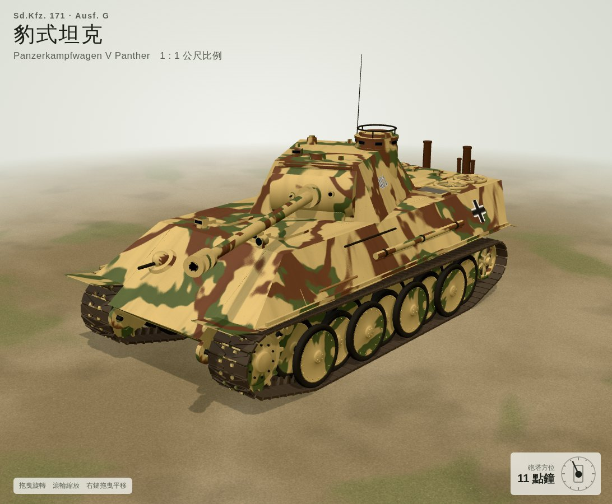

# 豹式坦克 G 型 3D 模型

V號戰車豹式（Pz.Kpfw. V Panther Ausf. G，Sd.Kfz. 171）的程序化 3D 模型，依實車諸元以 1:1 公尺比例建模。

## 檔案

| 檔案 | 說明 |
| --- | --- |
| `index.html` | 互動檢視器：砲塔旋轉、主砲俯仰、開火、行駛、四種塗裝、側裙板，也能匯出模型 |
| `models/panther_ausf_g.glb` | glTF 2.0 模型，含迷彩貼圖與材質，可匯入 Blender、Unity、Unreal、Godot |
| `models/panther_ausf_g_1-35.stl` | 3D 列印用，1:35、單位毫米（約 252 × 95 × 85 mm，已移除天線） |
| `preview.jpg` | 預覽圖 |

用瀏覽器直接開啟 `index.html` 即可，需要連網載入 three.js。檢視器匯出的 GLB、STL、OBJ 會以 ZIP 封裝，內容與當下的姿態、塗裝相同。

## 模型結構

- 單位公尺，+Y 朝上，車頭朝 +Z，車體左側為 +X
- 約 7.1 萬個三角形，每個零件依材質合併，共 12 種材質
- `Turret` 的原點在砲塔座圈中心，繞 Y 軸即可旋轉；`Gun` 的原點在砲耳，繞 X 軸即可俯仰；`Barrel` 可沿 Z 軸做後座
- `SkirtsL`、`SkirtsR` 是側裙板，不需要時隱藏或刪除即可
- 履帶每側 90 節，走向由主動輪、托輪、誘導輪與負重輪外緣計算

## 建模依據

- 全長 8.66 m（砲管朝前）、車體長 6.87 m、全寬 3.27 m（含側裙 3.42 m）、全高 2.99 m
- 上首上裝甲 55°、側上裝甲約 30°、後裝甲 30°；砲塔正面 11°、側面與後面 25°
- 每側 8 組交錯負重輪（直徑 860 mm）、履帶寬 660 mm、主動輪 17 齒
- G 型特徵：下巴式防盾、取消駕駛員觀察窗、駕駛與無線電手改用潛望鏡、指揮塔凸出砲塔左側

工具、艙蓋、引擎甲板格柵等細部依照片比例簡化重建，不是精確的工程圖。
